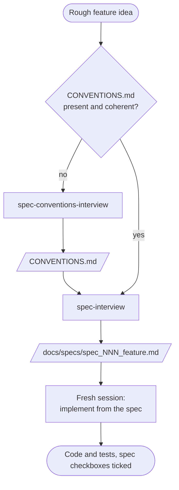

# agent-skills

[](https://skills.sh/esavard/agent-skills)

Personal collection of Agent Skills for spec-driven development, managed with the
[skills.sh](https://skills.sh) CLI ([vercel-labs/skills](https://github.com/vercel-labs/skills)).

## Why

An agent given a vague prompt has to guess: what you meant, which files matter, and where it
is allowed to make changes. Each guess costs tokens, and a wrong one costs a rewrite.

These skills replace the guessing with a short interview. The agent asks you one question at a
time, refuses vague answers, and writes down only what it needs to know to build one feature.
The implementation then starts in a fresh session with that spec as its contract.

What you get:

- **Less context.** The implementing agent reads one spec and `CONVENTIONS.md`, not the whole
  repository and not the interview that produced them.
- **A smaller blast radius.** The spec names the modules in scope and what is out of scope, so
  the agent has no reason to touch anything else.
- **Fewer hallucinations.** Paths, modules, and stack choices are checked against the repo
  during the interview, and every requirement has a checkable acceptance criterion.
- **Lower cost.** Sessions run on a small, stable context, so the prompt cache hit rate stays
  above 95% most of the time. That keeps costs contained compared to prompting by trial and
  error, where each retry grows the context.

### Why so opinionated?

The conventions interview pushes you toward DDD and automated architecture tests. That is on
purpose: together they produce isolated subsystems, and an agent working inside one of them
does not need the big picture.

The architecture tests (ArchUnit, `import-linter`, `dependency-cruiser`, and the like) are what
keep it honest. Because the agent has to write and run them, it often catches its own boundary
violations and fixes them before the code ever reaches your review.

## Workflow



1. **Conventions, once per repo.** `spec-conventions-interview` records your architecture,
   testing, and dependency rules in `CONVENTIONS.md`. `spec-interview` runs it for you if the
   file is missing or contradicts itself.
2. **Spec, once per feature.** `spec-interview` turns the idea into
   `docs/specs/spec_NNN_<feature>.md`: scope, out of scope, an architecture diagram,
   requirements with acceptance criteria, and a definition of done.
3. **Implementation, in a fresh session.** `spec-interview` hands you a one-line kick-off
   message to paste into a new session. `spec-implement` then works from the spec and
   `CONVENTIONS.md`. It ticks each checkbox the moment the item is verified, and an item left
   unchecked needs `(manual)` or `NOT DONE: <reason>`. It cannot report the work as finished
   until `scripts/check_spec.py` passes, so a green summary never hides an unchecked box.

### Specs are snapshots, not documentation

With this method the source code is always the source of truth, never the specs. A spec works
like an ADR: a snapshot of one development effort at a given moment in the life of the
repository. Once the feature is built, the spec stays as a record of what was decided and why.
It is not updated to follow the code, and later specs read it only for historical intent.

### Adapting the workflow to one repository

Do not fork a skill to fit a repository. Put the repository's own rules in a section of its
`AGENTS.md` (or `CLAUDE.md`), and the skills apply them on top of the generic workflow:

```markdown
## Spec workflow overrides
- Specs for an app go in `apps/<slug>/docs/specs/`, numbered per app.
- `CONVENTIONS.md` at the monorepo root applies to every app.
- Definition of Done always includes: `make verify` passes.
- Hand-off: the new session starts with the `app-builder` skill.
```

The section can change where specs and `CONVENTIONS.md` live, what to read or run before the
interview, the Definition of Done and the hand-off. It cannot relax the interview itself, nor
the checkbox protocol and completion gate of `spec-implement`.

## Skills

| Skill | Description |
| --- | --- |
| [spec-interview](skills/spec-interview/SKILL.md) | Turns a rough feature idea into a spec file under `docs/specs/` by interviewing you one question at a time. |
| [spec-conventions-interview](skills/spec-conventions-interview/SKILL.md) | Establishes or repairs the repo's `CONVENTIONS.md` through an interview. Prerequisite of `spec-interview`. |
| [spec-implement](skills/spec-implement/SKILL.md) | Implements one spec in a fresh session, ticks its checkboxes as items are verified, and cannot finish until `scripts/check_spec.py` passes. |

## Install

```bash
# all skills
npx skills add esavard/agent-skills

# list the skills without installing
npx skills add esavard/agent-skills --list

# a single skill
npx skills add esavard/agent-skills --skill spec-interview
```

### Plugin (Claude Code, managed updates)

An alternative to skills.sh, not in addition to it (installing both gives you every skill
twice). The plugin updates itself, but its files are read-only.

```bash
claude plugin marketplace add esavard/agent-skills
claude plugin install esavard-agent-skills@esavard
```

Inside a session: `/plugin install esavard-agent-skills --marketplace esavard/agent-skills`.
Install all three skills together: `spec-interview` hands off to `spec-implement` and calls
`spec-conventions-interview`.

## Update

Skills installed with skills.sh:

```bash
# see which installed skills have a newer version
npx skills check

# update every installed skill
npx skills update

# update a single skill
npx skills update spec-interview
```

Add `-g` to update only global skills, `-p` for project skills, or `-y` to skip the scope prompt.
A plugin install updates through Claude Code's `/plugin` manager instead.

## Use in a project without committing a copy

`npx skills add` records what it installed in `skills-lock.json`. Commit that file, ignore the
installed directories, and each clone restores the skills from this repository:

```bash
npx skills add esavard/agent-skills -y     # once: writes skills-lock.json
npx skills install                         # in a fresh clone: restores from skills-lock.json
```

## Usage

Once installed, the agent loads a skill when your request matches its description, for example
"let's spec this out" or "interview me about this feature". You can also name the skill explicitly.

## Structure

Each skill lives in its own directory under `skills/` and contains a `SKILL.md` with YAML
frontmatter (`name`, `description`):

```
skills/
  <skill-name>/
    SKILL.md
    agents/openai.yaml    # Codex skill-picker metadata
    scripts/              # optional helpers (e.g. spec-implement/scripts/check_spec.py)
.claude-plugin/           # plugin.json + marketplace.json
tests/                    # unit tests for helper scripts and manifest sync
```

The plugin manifest must list every skill; `tests/test_manifest.py` fails when it does not.

## Contributing

See [CONTRIBUTING.md](CONTRIBUTING.md). Validate changes with:

```bash
python3 scripts/validate_skills.py
python3 -m unittest discover -s tests
```

## License

MIT, see [LICENSE](LICENSE).
