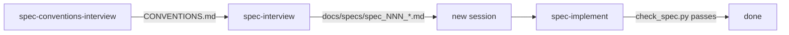

# agent-skills

[](https://skills.sh/esavard/agent-skills)

Spec-driven development skills for coding agents, following the [Agent Skills](https://agentskills.io) open format (`SKILL.md` + YAML frontmatter). Works with any agent that supports the format (Claude Code, Codex, and others).

The workflow splits planning and execution into separate sessions so each one stays small and cache-friendly:



| Skill | Purpose | Output |
|---|---|---|
| [spec-conventions-interview](skills/spec-conventions-interview/SKILL.md) | Establish or repair repo-wide engineering rules | `<repo root>/CONVENTIONS.md` |
| [spec-interview](skills/spec-interview/SKILL.md) | Interview the user, one question at a time, into a spec | `<repo root>/docs/specs/spec_NNN_<name>.md` |
| [spec-implement](skills/spec-implement/SKILL.md) | Execute a spec, keep its checkboxes accurate, gate completion | code + updated spec |

## Layout

```
skills/
  <skill-name>/
    SKILL.md        # frontmatter (name, description, license, metadata) + instructions
    assets/         # templates loaded only when needed
    scripts/        # executable helpers
    agents/openai.yaml  # Codex skill-picker metadata
.claude-plugin/     # plugin.json + marketplace.json (Claude Code, Codex, Copilot)
tests/              # unit tests for scripts and manifest sync
```

Directory name equals the `name` field. Templates live in `assets/` so they are loaded on demand rather than on every activation.

## Install

Pick one route per agent: the plugin updates itself, skills.sh copies editable files you update by hand. Installing both gives you every skill twice.

### Claude Code

```bash
claude plugin marketplace add esavard/agent-skills
claude plugin install esavard-agent-skills@esavard
```

Inside a session: `/plugin install esavard-agent-skills --marketplace esavard/agent-skills`.

### Codex

```bash
codex plugin marketplace add esavard/agent-skills
codex plugin add esavard-agent-skills@esavard
```

### GitHub Copilot CLI

```bash
copilot plugin marketplace add esavard/agent-skills
copilot plugin install esavard-agent-skills@esavard
```

### Any other agent, or editable copies (skills.sh)

```bash
npx skills@latest add esavard/agent-skills            # all skills, choose agent interactively
npx skills@latest add esavard/agent-skills --skill=spec-implement
```

Update with `npx skills@latest update`. Install all three skills together: `spec-interview` hands off to `spec-implement` and calls `spec-conventions-interview`.

## Checkbox protocol

Specs are execution contracts; their checkboxes are the progress record.

| Item state | Line format |
|---|---|
| Done and verified | `- [x] Item` |
| Needs a human (tagged when the spec is written) | `- [ ] (manual) Item` |
| Not done, any other reason | `- [ ] Item NOT DONE: <concrete reason>` |

`spec-implement` checks each item as soon as it is verified and refuses to report completion until `skills/spec-implement/scripts/check_spec.py <spec>` exits 0. The protocol is also copied into each spec and into the kick-off message, so an agent without the skill installed still sees it.

Optional hard enforcement: run the script from your agent's end-of-turn hook (e.g. a Claude Code `Stop` hook) or from CI on the branch that implements the spec.

## Development

```bash
pip install skills-ref
for d in skills/*/; do agentskills validate "$d"; done
python3 -m unittest discover -s tests -v
claude plugin validate . --strict
```

Release: bump `version` in `.claude-plugin/plugin.json`; plugin installs only update when it changes.

CI runs the same commands (`.github/workflows/validate.yml`).
