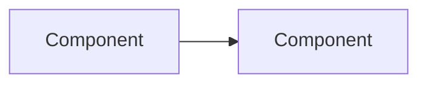

# spec_001_<short_feature_description>

> **Implementing agent protocol (mandatory; skill `spec-implement` automates it):**
> 1. Check `- [ ]` to `- [x]` in THIS file the moment each item is verified. No batching at end of session.
> 2. Item not done: leave unchecked, append `NOT DONE: <concrete reason>` on the same line. Items tagged `(manual)` need no reason.
> 3. Before claiming completion: every unchecked item carries `(manual)` or `NOT DONE:`. Verify with `spec-implement/scripts/check_spec.py <this file>` when available. End with a report listing NOT DONE and `(manual)` items.

## 1. Spec
**Title:** <one line>
**Goal:** <outcome-focused, one sentence>
**Scope:** <bullet list, each a testable behavior>
**Out of scope:** <bullet list>

## 2. Context
**Project:** <name>
**Relevant modules/paths:** <list, confirmed against repo>
**Tech stack:** <language, framework, key libs>
**Existing architecture notes:** <link to CONVENTIONS.md, or "none yet">
**Related specs:** <none, first spec>
**Spec nature:** <Domain logic | UI/presentation only | Mixed>

## 3. Architecture Diagram (Mermaid)

## 4. Requirements
> Protocol at top of file applies: check on verification; unchecked = `(manual)` or `NOT DONE: <reason>`.

- [ ] Requirement 1. Acceptance: <observable, checkable condition>
- [ ] Requirement 2. Acceptance: <observable, checkable condition>

## 5. Deliverables
- <file/module/test suite>

## 6. Implementation Plan
<omit this section if the feature has no independent milestones>

## 7. Engineering Rules
Follow `CONVENTIONS.md`. <deltas/exceptions specific to this spec, if any>

## 8. Definition of Done
> Protocol at top of file applies: check on verification; unchecked = `(manual)` or `NOT DONE: <reason>`.

- [ ] <standard checklist item from CONVENTIONS.md>
- [ ] <feature-specific item from interview>
- [ ] (manual) <item only a human can verify, e.g. smoke test against real database>
